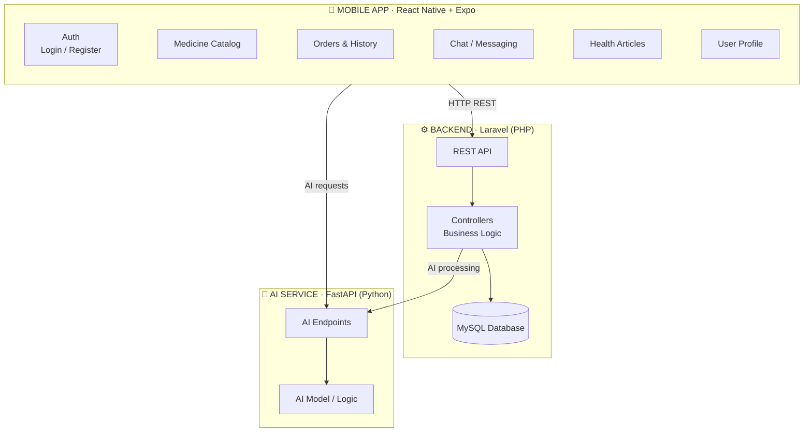

<div align="center">

# Apotek App

### Mobile Pharmacy Application with AI-Powered Features

A full-stack mobile pharmacy app — medicine catalog, order management, and an AI health assistant — built with React Native, Laravel, and FastAPI.

<br/>


</div>

---

## ✨ Features

| Feature | Description |
|:---|:---|
| 🔐 **Authentication** | Login & register with secure session handling |
| 💊 **Medicine Catalog** | Browse and search medicine products |
| 🛒 **Orders** | Place orders and view full transaction history |
| 📰 **Health Articles** | Curated health content for users |
| 💬 **Chat / Messaging** | In-app messaging feature |
| 👤 **User Profile** | Manage personal account details |
| 🤖 **AI Service** | FastAPI-powered AI backend for intelligent features |

---

## 🛠️ Tech Stack

| Layer | Technology | Role |
|:---|:---|:---|
| **Mobile** | React Native · Expo · TypeScript | Cross-platform mobile UI |
| **Backend** | Laravel · PHP | REST API, auth, business logic |
| **AI Service** | FastAPI · Python | AI-powered features |

---
## 🏗️ Architecture



## 🚀 Quick Start

### Backend (Laravel)
```bash
cd backend
composer install
cp .env.example .env
php artisan key:generate
php artisan migrate
php artisan serve
```

### AI Service (FastAPI)
```bash
cd ai-service
python -m venv .venv
.venv\Scripts\activate        # Windows
# source .venv/bin/activate   # macOS / Linux
pip install -r requirements.txt
uvicorn main:app --reload --port 8001
```

### Mobile App (Expo)
```bash
cd mobile
npm install
npx expo start
```

Scan the QR code with **Expo Go** on your phone, or press `a` for Android emulator / `i` for iOS simulator.
